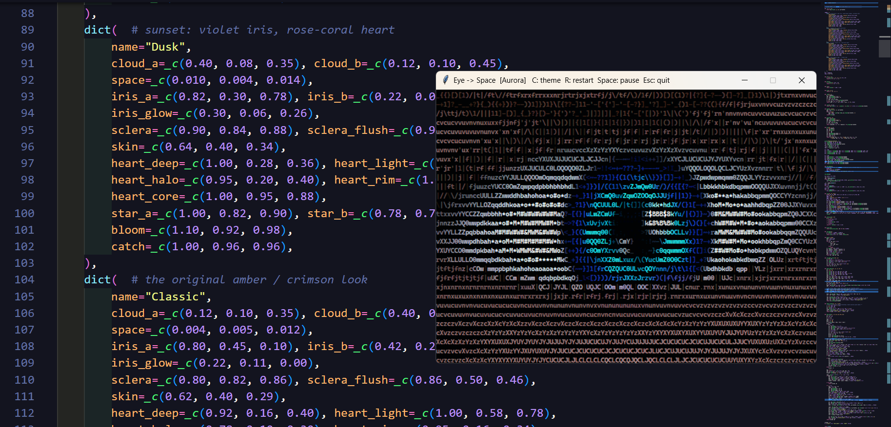

# Eye → Space

A Python animation that transforms a detailed, blinking eye into a journey through space, rendered as colorful ASCII art in a desktop window.

## Preview



## Features

- Animates an eye opening and blinking before transitioning into a star-filled space scene.
- Renders the animation as shaded, colored ASCII characters.
- Includes four color themes: Aurora, Emerald & Gold, Dusk, and Classic.
- Supports pausing, restarting, and switching themes while the animation runs.
- Can loop through the animation or remain in the space scene.

## Requirements

- Python 3.8 or newer
- NumPy
- Tkinter (included with most Windows and macOS Python installers; on Debian or Ubuntu, install with `sudo apt install python3-tk`)

Install NumPy if needed:

```bash
python -m pip install numpy
```

## Run

From the project directory:

```bash
python eye.py
```

## Options

```bash
python eye.py --theme Aurora
python eye.py --theme 2 --rows 24 --fps 40
python eye.py --no-loop
python eye.py --list-themes
```

- `--theme NAME|N`: choose a theme by name or index (default: `0`, Aurora).
- `--rows N`: set the number of text rows (default: fit the screen, up to 30).
- `--fps N`: set the target frame rate (default: `30`; minimum: `5`).
- `--no-loop`: keep the space scene on screen instead of fading out and restarting.
- `--list-themes`: print the available theme names and indexes, then exit.

While the animation is running, press **C** to change the theme, **R** to restart, **Space** to pause or resume, and **Esc** to quit.
